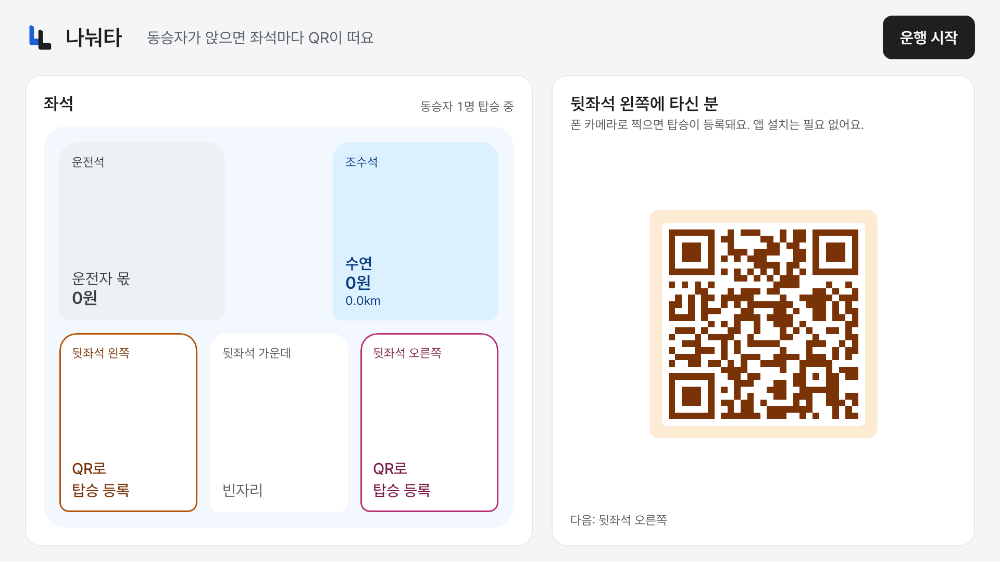
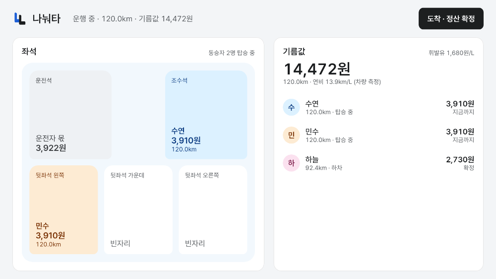
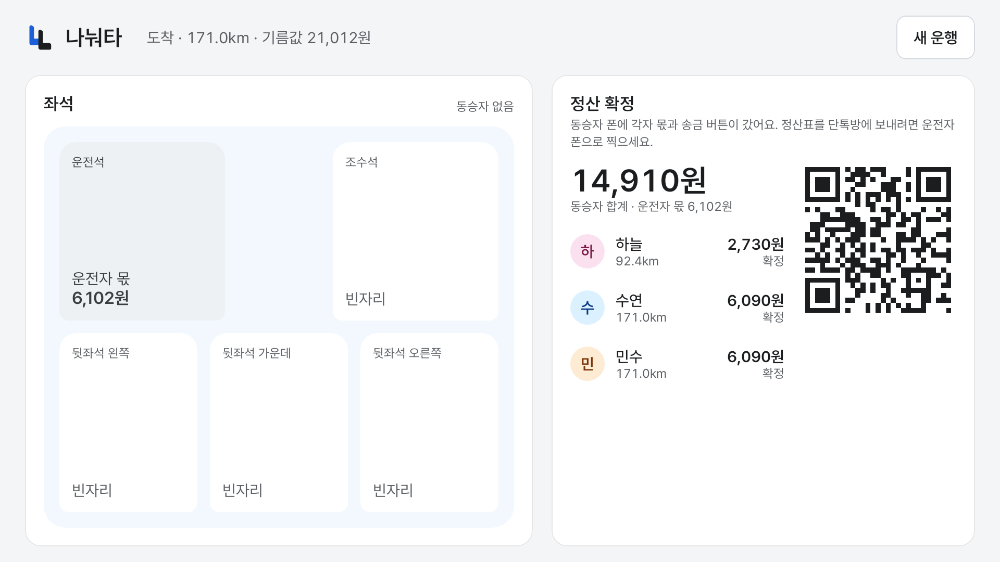

# 나눠타

탈 때 QR 한 번, 내리면 폰에 내 몫이 뜬다 — 차가 아는 좌석·주행거리·실제 연비로 함께 탄 사람들의 기름값을 구간별로 자동 정산하는 Pleos Connect 차량용 앱.

## 구성

| 폴더 | 내용 |
|---|---|
| `app/car` | 차량 앱 (Kotlin, Jetpack Compose, Pleos Connect SDK) |
| `app/core` | 정산 계산 `TripMeter` (Android 의존 없음, JVM 단위 테스트) |
| `server` | 중계 서버 + 동승자 모바일 웹 (Node 23.6+, 의존성 없음) |
| `apk/` | 실행 가능한 release APK |

```
[차량 앱] 좌석·도어·주행거리·연비 → 구간 정산 ─┐
                                              ├─ [서버] ─ [동승자 폰 웹] QR 체크인 · 내 몫 · 송금
[차량 앱] 좌석별 QR (정차 중에만) ─────────────┘
```

## 화면

| 탑승 — 앉은 좌석마다 QR | 중간 하차 — 자동 하차·금액 확정 | 도착 — 정산 확정 |
|---|---|---|
|  |  |  |

차량 화면은 `./gradlew :car:recordPaparazziDebug`로 앱의 Compose 화면을 그대로 렌더한 것 (`car/src/test/.../CarScreenShots.kt`).

## 실행 방법

### 1. 서버

```bash
cd server
DEMO=1 node server.ts          # http://localhost:8787  (DEMO=1은 시연 운행 'demo'를 만든다)
```

- 시연 화면: `http://localhost:8787/s/demo` (정산표), `/t/demo?rider=hn` (하차한 동승자의 청구서), `/t/demo?rider=ms` (탑승 중)
- 환경 변수: `PORT`, `PUBLIC_URL`(QR에 들어갈 주소, 폰에서 접속 가능해야 함), `KAKAO_JS_KEY`·`KAKAO_REST_KEY`(카카오 로그인·공유, 없으면 이름 입력으로 탑승)

### 2. 차량 앱

1. Android Studio에 Pleos Connect Emulator(API 34, `Pleos Connect v2.1.0`)를 설치한다. [설정 가이드](https://document.pleos.ai/docs/connect/guide/getting-started/application-development/setup-connect-sdk-emulator)
2. `apk/김해준_나눠타_release.apk`를 설치한다: `adb install apk/김해준_나눠타_release.apk`
   또는 소스에서: `cd app && ./gradlew :car:installDebug`
3. 에뮬레이터에서 본 PC의 서버는 `http://10.0.2.2:8787`(기본값). 다른 서버는 `./gradlew :car:assembleRelease -Pnanwota.server=https://...`

### 3. 시연 순서

1. Virtual Console > Convenience > **Seat Occupancy**에서 뒷좌석 오른쪽 착석 → 차 화면에 그 좌석 QR
2. 폰으로 QR 스캔 → 이름(또는 카카오)으로 탑승 → 차 화면 좌석에 이름, 음성 안내
3. 주행: Virtual Console **Odometer**를 올리거나, 차 화면 로고를 길게 눌러 시연 패널에서 `+20km`
4. 하차: 좌석 비움 + **Door Position** 열림 → 자동 하차, 폰에 확정 금액과 송금 버튼
5. `도착 · 정산 확정` → 정산표 QR → 단톡방 공유

## 테스트 환경 및 필요한 설정

- Pleos Connect Emulator v2.1.0 (Android API 34 Automotive), Vehicle SDK 2.3.2, TextToSpeech 3.3.1
- minSdk 28 · compileSdk 34 · Gradle 8.9 · AGP 8.5 · Kotlin 1.9.24 · JDK 17
- 퍼미션: 조회 전용 `pleos.car.permission.CAR_SEATS`, `CAR_DOORS`, `CAR_DRIVE`, `CAR_ENERGY`, `TTS_SERVICE` (제어 퍼미션 없음)
- 에뮬레이터 Virtual Console에는 연비·전비 카드가 없어, 차량이 연비를 주지 않으면 설정 평균 연비(휘발유 12.5km/L, 전기 5.2km/kWh)로 계산하고 화면에 "(설정값)"으로 표시한다
- 주행 중(`CarUxRestrictions.UX_RESTRICTIONS_NO_SETUP`)에는 QR을 표시하지 않는다

### 테스트

```bash
cd app && ./gradlew :core:test      # 구간 정산 단위 테스트
```

## APK

`apk/김해준_나눠타_release.apk`
